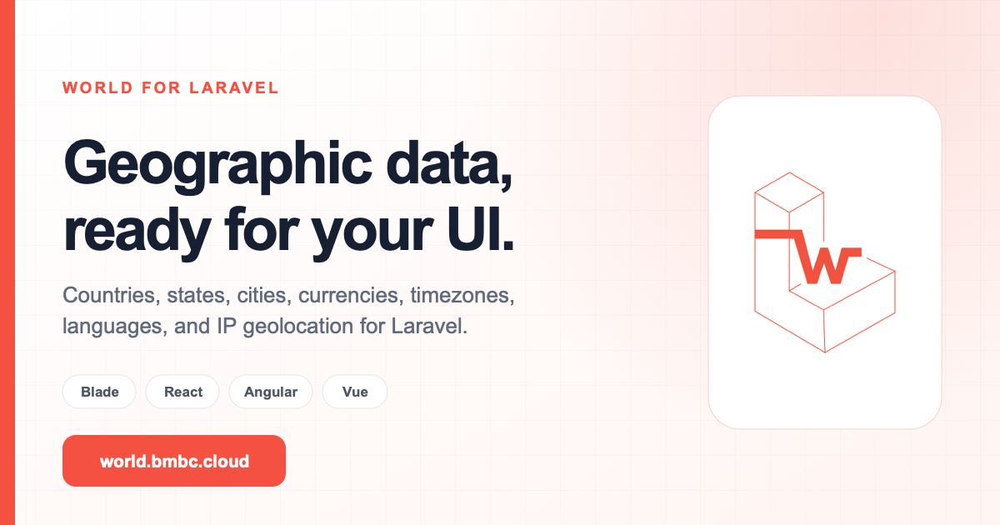

<p align="center">
  <a href="https://world.bmbc.cloud">
    
  </a>
</p>

# World for Laravel

Add countries, states, cities, timezones, currencies, languages, and IP geolocation to a
Laravel application. Query the data through the World facade or API routes, then use the
[live selector examples](https://world.bmbc.cloud/components) to build your UI.

## Get started with World 2.0

```bash
composer require nnjeim/world:^2.0
```

Prepare your configured cache store before installing the data. If your application uses
Laravel's database cache, run `php artisan migrate` first to create its cache and lock
tables. World installation runs only World migrations.

```bash
php -d memory_limit=1G artisan world:install
```

Query a country with the World facade:

```php
use Nnjeim\World\World;

$result = World::countries([
    'filters' => ['iso2' => 'RO'],
]);

if ($result->success) {
    $countries = $result->data;
}
```

## See it in a UI

Try the [country selector](https://world.bmbc.cloud/components/country-selector) or the
[dependent country, state, and city selector](https://world.bmbc.cloud/components/location-selector).
Both have live previews and copy-ready Blade, React, Angular, and Vue examples. The examples
use World's Laravel API routes; they do not require another frontend package.

## Upgrading from 1.x?

World 2.0 changes data maintenance: refresh and seeding preserve tables and existing IDs,
with source tracking and dry runs. Read the [upgrade guide](docs/2.0/UPGRADE.md) before
changing your Composer constraint. It covers backups, local edits, the first import's
limitations, and the required memory and cache setup. You can also keep using the
[1.x documentation](docs/1.x/README.md).

## Choose your documentation

| Version | Status | Documentation |
| --- | --- | --- |
| **2.0.1** | Current stable release; changes to data maintenance from 1.x | [World 2.0 guide](docs/2.0/README.md) · [Upgrade from 1.x](docs/2.0/UPGRADE.md) |
| **1.1.39** | Previous stable release; PHP 8.1+, Laravel 10–13 | [World 1.x guide](docs/1.x/README.md) |
| **1.1.38** | Published legacy release; PHP >=7.4 requirement, GeoIP2 v2 | [Original 1.1.38 guide](https://github.com/nnjeim/world/blob/1.1.38/README.md) |

Published versions with retained Git tags keep their original code. Removing an old
GitHub release page does not remove its Git tag. Use the documentation at your installed
tag for its exact behavior; retain published tags to keep those versions available.

## Stay on World 1.x

```bash
composer require nnjeim/world:^1.1.39
```

For an exact 1.1.38 installation:

```bash
composer require nnjeim/world:1.1.38
```

`^1.1` and `^1.1.39` stay below 2.0. Existing lock files retain their selected versions
when running `composer install`. Constraints such as `*`, `>=1.1` and `dev-master` can
select a different major version; review your constraint before updating.
See [Composer version constraints](https://getcomposer.org/doc/articles/versions.md).

## Links

- [Complete World 2.0 documentation](docs/2.0/README.md)
- [Interactive documentation and UI examples](https://world.bmbc.cloud)
- [Packagist](https://packagist.org/packages/nnjeim/world)
- [Changelog](CHANGELOG.md)
- [Upgrade guides](UPGRADE.md)
- [Contributing](CONTRIBUTING.md)
- [Dataset sources and attribution](docs/DATA_SOURCES.md)
