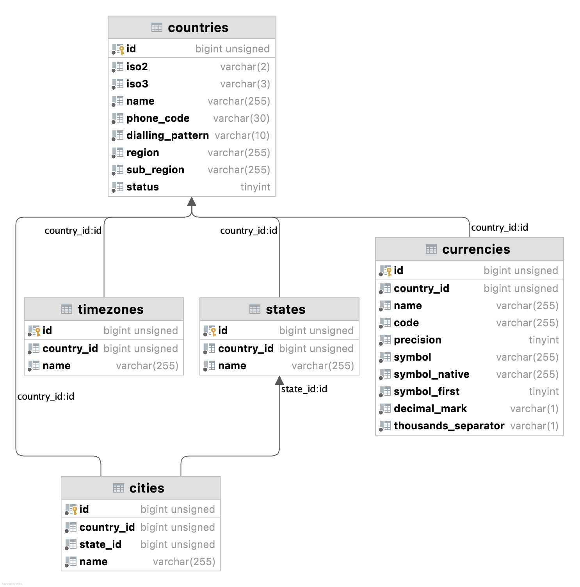

# World 2.0.0 documentation

**Status: planned release; 2.0.0 has not been published.** These instructions apply to
the 2.0 code in PR #159. For currently published packages, use the
[World 1.x documentation](../1.x/README.md). Existing 1.1 tags retain their original code.

Read the [upgrade guide](UPGRADE.md) before moving an existing installation to 2.0.

<p align="center">
  <a href="https://world.bmbc.cloud">
    
  </a>
</p>

<p align="center">
<a href="https://packagist.org/packages/nnjeim/world"></a>
<a href="https://packagist.org/packages/nnjeim/world"></a>
<a href="https://packagist.org/packages/nnjeim/world"></a>
</p>

The World is a Laravel package that provides a comprehensive list of countries, states, cities, timezones, currencies, languages and IP geolocation. You can access the data using the **World Facade** or through defined API routes.

---

## Interactive documentation and UI examples

Explore the package at **[world.bmbc.cloud](https://world.bmbc.cloud)**. The companion documentation site provides live API-backed previews and copy-ready selector examples for **Blade, React, Angular, and Vue**.

- [Country selector](https://world.bmbc.cloud/components/country-selector)
- [Dependent country, state, and city selector](https://world.bmbc.cloud/components/location-selector)
- [Currency selector](https://world.bmbc.cloud/components/currency-selector)
- [Language selector](https://world.bmbc.cloud/components/language-selector)
- [Timezone selector](https://world.bmbc.cloud/components/timezone-selector)

The examples consume the Laravel API routes exposed by this package; no additional frontend package is required.

---

<p align="center">
  
</p>

<p align="center">
  <strong>🌍 Planned for v2.0.0: preserving data updates and country flags</strong><br/>
  Stable existing IDs, tracked local edits, dry runs, World cache invalidation, and Cayman data additions.<br/>
  <a href="#whats-new-in-v200">Learn more →</a>
</p>

---

## Table of Contents

- [Interactive documentation and UI examples](#interactive-documentation-and-ui-examples)
- [Upgrade from 1.x](UPGRADE.md)
- [Country flags](#country-flags)
- [Installation](#installation)
  - [Automated Installation](#automated-installation)
  - [Manual Installation](#manual-installation)
- [What's New in v2.0.0](#whats-new-in-v200)
- [Changelog](#changelog)
- [Contributing](#contributing)
- [Examples](#examples)
- [Usage](#usage)
  - [List All Countries](#list-all-countries)
  - [Fetch Country with States & Cities](#fetch-country-with-states--cities)
  - [List All Cities by Country ID](#list-all-cities-by-country-id)
- [Available Actions](#available-actions)
- [Available API Routes](#available-api-routes)
  - [Countries](#countries)
  - [States](#states)
  - [Cities](#cities)
  - [Timezones](#timezones)
  - [Currencies](#currencies)
  - [Languages](#languages)
  - [Geolocate](#geolocate)
- [Localization](#localization)
- [Schema](#schema)
- [Configuration](#configuration)
- [Testing](#testing)
- 
### Installation

Install the package via Composer:

```
composer require nnjeim/world:^2.0
```

Optionally, set the WORLD_DB_CONNECTION environment variable to your desired database connection.

#### Automated Installation

Run the following Artisan command to automate the installation process:

```
php artisan world:install
```
#### Manual Installation
If you prefer to install the package manually, follow these steps:

1. Publish the package configuration file:

```bash
php artisan vendor:publish --tag=world
```
2. Run the migrations:

```bash
php artisan migrate 
```
3. Seed the database:

```bash
php artisan db:seed --class=WorldSeeder
```

### Upgrading

Update the package, preview the data changes, and apply them:

```bash
composer require nnjeim/world:^2.0
php artisan world:refresh --dry-run
php artisan world:refresh
# In production:
php artisan world:refresh --force
```

Installation and refresh preserve existing database IDs and application records. The installer
publishes missing files without overwriting customized configuration. See
[installation and data updates](DATA_UPDATES.md) for legacy adoption, local edits,
custom connections, cache invalidation and schema changes. These preserving commands are
introduced in v2.0.0; see [UPGRADE.md](UPGRADE.md) when upgrading an older installation.

### Country flags

Request a computed Unicode flag alongside the country ISO2 code:

```php
$action = World::countries([
    'fields' => 'iso2,flag',
    'filters' => ['iso2' => 'FR'],
]);
// data: [{"id": ..., "name": "France", "iso2": "FR", "flag": "🇫🇷"}]
```

The equivalent API query is `GET /api/countries?fields=iso2,flag&filters[iso2]=FR`.
The field is optional and needs no database column or configuration change. To derive a flag
in application code, use `Nnjeim\World\CountryFlag::emoji('FR')`. Rendering depends on the
platform's emoji fonts; for SVG or PNG flags, use the returned `iso2` with your chosen flag
assets. The package performs no external image requests.

### Data quality and sources

The bundled data is checked for unique source IDs, consistent country and state references,
copied codes, coordinate ranges and localization keys. The reviewed
[data manifest](../../resources/data-manifest.json) records counts, checksums and country coverage.
Sources, attribution and the review policy are documented in
[DATA_SOURCES.md](../DATA_SOURCES.md). Cayman coverage includes six districts and 15
populated places with verified district associations.

### What's new in v2.0.0?

- Installation, refresh and seeding preserve existing application IDs and custom rows.
- Tracked imports preserve subsequent local edits and support source renames and moves.
- Commands support previews and production updates with `--force`.
- Migration rollback retains World data and tracking tables.
- Added an optional computed `flag` field and `CountryFlag::emoji()` helper.
- Added six Cayman districts and 15 populated places, with source attribution.
- Added data integrity checks and a reproducible coverage and checksum manifest.
- Successful imports invalidate World caches; application cache entries are retained.
- PHP 8.1+ and Laravel 10–13 remain the supported runtime range.

Maintenance behavior changes are listed in [UPGRADE.md](UPGRADE.md).

### Changelog

For detailed information on recent changes, please see the [CHANGELOG](../../CHANGELOG.md).

### Contributing

We welcome contributions! For details on how to get started, please review our [CONTRIBUTING](../../CONTRIBUTING.md) guidlines.
  
## Examples

Use the [interactive documentation](https://world.bmbc.cloud) to try the selectors, switch between Blade, React, Angular, and Vue implementations, and copy the corresponding source code.

You can also inspect the live API directly:

| Example | Live endpoint |
|:--------|:--------------|
| List all countries | [`GET /api/countries`](https://world.bmbc.cloud/api/countries) |
| Search for Romania | [`GET /api/countries?search=rom`](https://world.bmbc.cloud/api/countries?search=rom) |
| Get Romanian states and their cities | [`GET /api/states?filters[country_code]=RO&fields=cities`](https://world.bmbc.cloud/api/states?filters%5Bcountry_code%5D=RO&fields=cities) |

### Usage

#### List all the countries

Use the `World` facade:

```php
use Nnjeim\World\World;

$action =  World::countries();

if ($action->success) {
  $countries = $action->data;
}

response (object)
{
  "success": true,
  "data": [
    {
      "id": 1,
      "name": "Afghanistan"
    },
    {
      "id": 2,
      "name": "Åland Islands"
    },
    .
    .
    .
  ],
}
``` 

Use the API countries endpoint:

```
https://myDomain.local/api/countries
```

#### Fetch a country with its states and cities.

Use the `World` facade:

```php
use Nnjeim\World\World;

$action =  World::countries([
	'fields' => 'states,cities',
	'filters' => [
		'iso2' => 'FR',
	]
]);

if ($action->success) {

	$countries = $action->data;
}
```

Response: 
```
(object)
{
  "success": true,
  "data": [
    "id": 77,
    "name": "France",
    "states": [
        {
          "id": 1271,
          "name": "Alo"
        },
        {
          "id": 1272,
          "name": "Alsace"
        },
        .
        .
        .
    ],
    "cities": [
        {
          "id": 25148,
          "name": "Abondance"
        },
        {
          "id": 25149,
          "name": "Abrest"
        },
        .
        .
        .
      ]
    ],
}
```

Use the API countries endpoint:

```
https://myDomain.local/api/countries?fields=states,cities&filters[iso2]=FR
```

#### List all the cities by country id

```php
use Nnjeim\World\WorldHelper;

new class {
    protected $world;
    
    public function __construct(WorldHelper $world) {
        $this->world = $world;
    }
    
    $action = $this->world->cities([
        'filters' => [
            'country_id' => 182,
        ],
    ]);
    
    if ($action->success) {
        $cities = $action->data;
    }
}
```

Use the API cities endpoint:

```
https://myDomain.local/api/cities?filters[country_code]=RO 
```

### Available actions

| Name       | Description                   |
|:-----------|:------------------------------|
| countries  | lists all the world countries |
| states     | lists all the states          |
| cities     | lists all the cities          |
| timezones  | lists all the timezones       |
| currencies | lists all the currencies      |
| languages  | lists all the languages       |
| geolocate  | geolocates an IP address      |

An action response is formed as below:

* `success` (boolean)
* `message` (string)
* `data` (instance of `Illuminate\Support\Collection`)
* `errors` (array)

#### Countries action

* `fields`*: comma separated string (countries table fields in addition to states, cities, currency and timezones).
* `filters`*: array of keys (countries table fields) and their corresponding values.
* `search`*: string.

#### States action

* `fields`*: comma separated string (states table fields in addition to country and states).
* `filters`*: array of keys (states table fields) and their corresponding values.
* `search`*: string.

#### Cities action

* `fields`*: comma separated string (cities table fields in addition to country and state).
* `filters`*: array of keys (cities table fields) and their corresponding values.
* `search`*: string.

#### Timezones action

* `fields`*: comma separated string (timezones table fields in addition to country).
* `filters`*: array of keys (timezones table fields) and their corresponding values.
* `search`*: string.

#### Currencies action

* `fields`*: comma separated string (currencies table fields in addition to country).
* `filters`*: array of keys (currencies table fields) and their corresponding values.
* `search`*: string.

#### Languages action

* `fields`*: comma separated string (languages table fields).
* `filters`*: array of keys (languages table fields) and their corresponding values.
* `search`*: string.

#### Geolocate action

Geolocate an IP address. Returns country, state, city, coordinates, and timezone information linked to existing World data.

* `ip`*: string (optional - auto-detects from request if not provided).

**Data Sources:**

1. **MaxMind GeoLite2** (local database, recommended for production)
2. **ip-api.com** (free fallback, no setup required, 45 req/min limit)

The package automatically falls back to ip-api.com if the GeoLite2 database is not installed. For production use, we recommend downloading the GeoLite2 database:

```bash
# Get a free license key at: https://www.maxmind.com/en/geolite2/signup
php artisan world:geoip --license=YOUR_LICENSE_KEY
```

Or set the `MAXMIND_LICENSE_KEY` environment variable and run:
```bash
php artisan world:geoip
```

To disable the fallback API, set `WORLD_GEOLOCATE_FALLBACK_API=false` in your `.env` file.

**Usage:**

```php
use Nnjeim\World\World;

// Auto-detect IP from request
$action = World::geolocate();

// Geolocate specific IP
$action = World::geolocate(['ip' => '8.8.8.8']);

if ($action->success) {
    $location = $action->data;
    // $location['country'], $location['state'], $location['city'], etc.
}
```

**How IP Detection Works:**

The client IP is automatically detected from request headers in this order:
1. `CF-Connecting-IP` (Cloudflare)
2. `X-Forwarded-For` (Standard proxy header)
3. `X-Real-IP` (Nginx proxy)
4. `CLIENT-IP` (Generic)
5. Laravel's `request()->ip()` fallback

**Response Format:**

```json
{
  "success": true,
  "message": "geolocations",
  "data": {
    "ip": "8.8.8.8",
    "country": {
      "id": 236,
      "iso2": "US",
      "iso3": "USA",
      "name": "United States",
      "phone_code": "1",
      "region": "Americas",
      "subregion": "Northern America"
    },
    "state": {
      "id": 4808,
      "name": "Virginia",
      "state_code": "VA"
    },
    "city": {
      "id": 147562,
      "name": "Ashburn"
    },
    "coordinates": {
      "latitude": 39.03,
      "longitude": -77.5,
      "accuracy_radius": null
    },
    "timezone": {
      "id": 404,
      "name": "America/New_York"
    },
    "postal_code": "20149"
  },
  "response_time": "690 ms"
}
```

> **Note:** The `id` fields link to existing records in the World database tables. If a matching record is not found, the `id` field will be omitted and only the raw geolocation data will be returned.

### Available API routes

All routes can be prefixed by any string. Ex.: `admin`, `api`...

#### Countries

|             |                                                                                                                                     |
|:------------|:------------------------------------------------------------------------------------------------------------------------------------|
| Method      | GET                                                                                                                                 |
| Route       | `/{prefix}/countries`                                                                                                               |
| Parameters* | comma separated fields (countries table fields in addition to states, cities, currency and timezones), array filters, string search |
| Example     | `/api/countries?fields=iso2,cities&filters[phone_code]=44  `                                                                        |   
| response    | success, message, data                                                                                                              |  

#### States

|             |                                                                                                              |
|:------------|:-------------------------------------------------------------------------------------------------------------|
| Method      | GET                                                                                                          |
| Route       | `/{prefix}/states`                                                                                           |
| Parameters* | comma separated fields (states table fields in addition to country and cities), array filters, string search |
| Example     | `/api/states?fields=country,cities&filters[country_code]=RO`                                                 |   
| response    | success, message, data                                                                                       |   

#### Cities

|             |                                                                                                             |
|:------------|:------------------------------------------------------------------------------------------------------------|
| Method      | GET                                                                                                         |
| Route       | `/{prefix}/cities`                                                                                          |
| Parameters* | comma separated fields (cities table fields in addition to country and state), array filters, string search |
| Example     | `/api/cities?fields=country,state&filters[country_code]=RO`                                                 |   
| response    | success, message, data                                                                                      | 

#### Timezones

|             |                                                                                                          |
|:------------|:---------------------------------------------------------------------------------------------------------|
| Method      | GET                                                                                                      |
| Route       | `/{prefix}/timezones`                                                                                    |
| Parameters* | comma separated fields (timezones table fields in addition to the country), array filters, string search |
| Example     | `/api/timezones?fields=country&filters[country_code]=RO`                                                 |   
| response    | success, message, data                                                                                   | 

#### Currencies

|             |                                                                                                           |
|:------------|:----------------------------------------------------------------------------------------------------------|
| Method      | GET                                                                                                       |
| Route       | `/{prefix}/currencies`                                                                                    |
| Parameters* | comma separated fields (currencies table fields in addition to the country), array filters, string search |
| Example     | `/api/currencies?fields=code&filters[country_code]=RO`                                                    |   
| response    | success, message, data                                                                                    |

#### Languages

|             |                                       |
|:------------|:--------------------------------------|
| Method      | GET                                   |
| Route       | `/{prefix}/languages`                 |
| Parameters* | comma separated fields, string search |
| Example     | `/api/languages?fields=dir`           |
| response    | success, message, data                |

#### Geolocate

|             |                                                                                      |
|:------------|:-------------------------------------------------------------------------------------|
| Method      | GET                                                                                  |
| Route       | `/{prefix}/geolocate`                                                                |
| Parameters* | ip (optional - auto-detects from request)                                            |
| Example     | `/api/geolocate` or `/api/geolocate?ip=8.8.8.8`                                      |
| response    | success, message, data (ip, country, state, city, coordinates, timezone, postal_code)|

### Localization

The available locales are 
```
ar, az, bn, br, de, en, es, fa, fr, hr, hu, hy, it, ja, kr, ne, nl, pl, pt, ro, ru, sw, tr and zh.
```
The default locale is en.

Header option

```
accept-language=locale
```

Alternatively, you can use specific locale with the `World` Facade `setLocale('locale')` helper method. Example: 

```php
World::setLocale('zh')->countries();
```

### Schema

<p></p>

### Configuration  
The configuration for the World package is located in the world.php file.  
If you're upgrading from a previous version, you may want to re-publish the config file:

```bash
php artisan vendor:publish --tag=world
```

#### Customizing database connection

By default, this package uses the default database connection, but it's possible to customize it
using the `WORLD_DB_CONNECTION` variable in your `.env` file.

#### Cache control

Action results are cached by default. To disable caching globally, set:

```dotenv
WORLD_CACHE_ENABLED=false
```

You can override the configured default for one action call:

```php
World::withoutCaching()->countries();
World::withCaching()->countries();
```

The override is reset after that action. Cache keys include Laravel's active locale, so localized results are stored separately.

### Countries restrictions
Countries can be restricted while seeding the database either by adding the ISO2 country codes in the `allowed_countries` or `disallowed_countries` array lists.  

#### Supported Locales  
A list of the accepted locales which relate to the localized [`lang/` files](../../resources/lang).

#### Modules enablement  
The states, cities, timezones, currencies and languages modules can be optionally disabled.    
Please note that the cities module depends on the states module.  

#### Routes  
If you don't wish to use the packages as an API service, you can disable all the routes by assigning `false` to `routes`.  

#### Migrations  
It offers the ability to enable or disable the database fields.  
When changing optional fields on an existing installation, add the columns through an application migration, then update the configuration. See [schema changes](DATA_UPDATES.md#schema-and-configuration-changes).

### Requirements

- PHP 8.1 or newer
- Laravel 10, 11, 12, or 13

### Testing

The test suite is self-contained and uses an in-memory SQLite database:

```bash
composer install # installs the package dev dependencies
composer test
```
